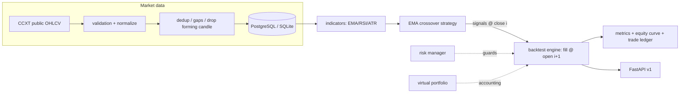

# Driftline architecture (v0.1)

## Data flow

## Anti-lookahead rule

Signals form on completed candle `i`. Fills occur at candle `i+1` open plus
slippage/fees. The engine never fills at the signal candle's own close.

## Equity convention

`equity = cash + position_qty * candle_close`, with fees realized on fills.
An open position at the end of history is marked to the last close, never
fabricated into an exit fill.
