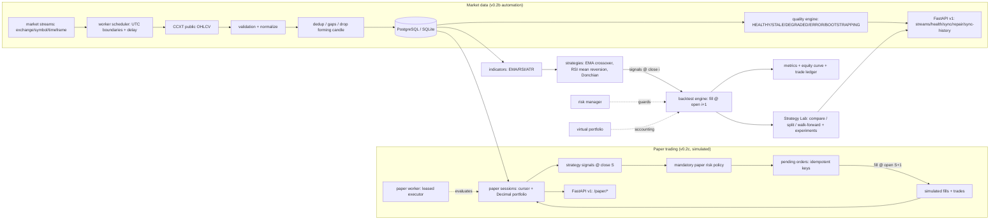

# Driftline architecture (v0.1 + v0.2a Strategy Lab + v0.2b Market Automation + v0.2c Paper Trading)

## Data flow

## Anti-lookahead rule

Signals form on completed candle `i`. Fills occur at candle `i+1` open plus
slippage/fees. The engine never fills at the signal candle's own close.

## Equity convention

`equity = cash + position_qty * candle_close`, with fees realized on fills.
An open position at the end of history is marked to the last close, never
fabricated into an exit fill.

## Market automation (v0.2b)

- One dedicated worker owns the scheduler; the API never schedules.
- Per-stream DB leases prevent duplicate jobs across processes.
- Candles are namespaced by `(exchange, symbol, timeframe)`; provenance flows
  into dataset fingerprints, so research snapshots are reproducible and
  exchange-scoped. See [market-automation](market-automation.md) and
  [data-quality](data-quality.md).

## Paper trading (v0.2c, simulated funds only)

- One dedicated paper worker evaluates `RUNNING` sessions; the API never runs
  trading loops. Per-session DB leases guarantee a single executor.
- Signals on completed candle `S` fill at completed candle `S+1`'s open —
  the same timing as the backtester (see [execution-model](execution-model.md)).
- Every order passes the mandatory paper risk policy (daily-loss UTC reset,
  drawdown, single position, stale data, persistent kill switch); risk
  parameters are server-side and never client-settable.
- Portfolio state is Decimal-precise and persistent (`paper_sessions` plus
  `paper_orders/fills/trades/snapshots/events`); evaluation ticks are atomic
  with idempotent order keys, so restarts never duplicate execution.
  See [paper-trading](paper-trading.md).

## Strategy Lab (v0.2a)

- `StrategyRegistry` validates and instantiates versioned strategies from
  explicit parameter schemas; all strategies emit engine-compatible signals.
- `research/comparison.py` evaluates N strategies on one identical snapshot
  (same candles, capital, costs, timing, benchmark); no winner score.
- `research/splits.py` cuts chronologically (default 70/30) with warmup
  prefixes and per-window capital reset; OOS never informs selection.
- `research/walk_forward.py` freezes grid-search winners on past training
  windows and scores them once on unseen, non-overlapping test windows;
  the aggregate comes from the concatenated OOS ledger with carry-forward
  capital. See [strategy-lab](strategy-lab.md).
- `experiments` table + `ExperimentRecord` (fingerprint, configs, code
  version, warnings) make every run reproducible and dashboard-queryable.
