# Driftline market automation (v0.2b)

Automated, restart-safe ingestion of completed spot OHLCV candles across
multiple configured markets, with explicit provenance and honest failure
reporting. No live trading — this pipeline only reads public market data.

## Ingestion pipeline

```mermaid
flowchart LR
    subgraph cfg["Configuration"]
        ENV[DRIFTLINE_MARKET_STREAMS]
        ENV --> STREAMS[MarketStream: exchange / symbol / timeframe / enabled]
    end
    subgraph worker["Worker process (single owner)"]
        SCHED[scheduler: UTC candle boundaries + sync delay] --> LOCK[per-stream DB lease]
        LOCK --> SYNC[incremental sync: latest persisted → expected close]
        SYNC --> FETCH[CCXT paginated fetch: only the missing interval]
        FETCH --> VAL[validate + drop forming candle + dedup]
        VAL --> UPSERT[idempotent upsert under exchange provenance]
        UPSERT --> GAPS[gap check: remaining holes preserved + reported]
        GAPS --> STATE[stream state + sync-run history]
    end
    STREAMS --> SCHED
    STATE --> API[FastAPI: streams / health / sync-history]
    UPSERT --> DB[(PostgreSQL / SQLite)]
    DB --> LAB[Strategy Lab: exchange-scoped research snapshots]
```



## Market configuration

`DRIFTLINE_MARKET_STREAMS` is a comma-separated list of
`exchange:SYMBOL:timeframe` entries. Defaults:

```text
binance:BTC/USDT:1h,binance:ETH/USDT:1h,binance:SOL/USDT:1h
```

- Prefix an entry with `!` to disable it without removing it.
- Symbols must be spot (`BASE/QUOTE`); futures markers (`:`, `PERP`, `SWAP`)
  are rejected — no leverage, perpetuals, margin, or derivatives.
- Timeframes use `1h`-style notation and are validated.
- The legacy `DRIFTLINE_EXCHANGE/SYMBOL/TIMEFRAME` triple still seeds a single
  stream when the list is empty (v0.1 behaviour preserved).

## Scheduling

- Syncs fire shortly after each UTC candle closes, plus a configurable
  `DRIFTLINE_SYNC_DELAY_SECONDS` (default 90s) for exchange publication latency.
- Timing derives from UTC candle boundaries, never from process startup time,
  so restarts converge on the same schedule.
- One poll tick (default 60s) checks every enabled stream; streams that are
  multiple candles behind sync immediately, others wait for the delay window.
- Failed streams back off (`5min × 2^(n-1)`, capped at 1h) instead of hot-looping.
- Jobs for the same stream never overlap: an in-process guard plus a DB-backed
  lease (`locked_by`/`locked_until`) ensure single ownership even if a second
  worker is started by accident. Supported deployment is **one worker**.

Process ownership: the scheduler runs **only** in the dedicated worker
(`python -m driftline.worker`, or the `worker` Compose service).
The API process never starts it (`DRIFTLINE_SCHEDULER_ENABLED=0` there).

## Bootstrap and incremental sync

- New streams bootstrap ~12 months of hourly candles (`DRIFTLINE_BOOTSTRAP_MONTHS`),
  bounded per run and paginated (1000/page). Progress is the persisted data
  itself: a restart resumes from the latest stored candle, never from scratch.
- `bootstrap_done` is set only on evidence: stored depth reaches the stream's
  `bootstrap_target`, or the provider is exhausted (returned fewer candles
  than requested) with no remaining gaps. A bounded partial pass never flips
  the flag, so the scheduler keeps bootstrapping instead of switching to
  incremental mode prematurely.
- Steady-state runs fetch only the interval after the latest persisted candle.
  Re-running with nothing new stores zero rows and reports success (`fetched=0`).
- History older than the earliest candle any provider returned is "unavailable
  from provider", not a gap. Gaps are holes *inside* observed history.

## Gap detection and repair

- After every sync, expected timestamps from the earliest stored candle to the
  last completed candle are diffed against the database; holes become
  `unresolved_gaps` on the stream row (capped at 100 for operability).
- `POST /api/v1/market/repair` (or the worker's recovery path) re-requests
  holes in bounded intervals (default ≤1000 candles, ≤10 intervals per call).
- A run whose expected interval is still incomplete reports `success=false`
  with an explanatory error. **Gaps are preserved, never interpolated or
  fabricated.** If the exchange has no data for a hole, it stays open.

## Provider resilience

- Timeouts (default 30s), bounded retries (default 5) with exponential backoff
  + jitter, and exchange rate-limit sleeps.
- Errors are classified: transient (timeouts, 5xx, rate limits, maintenance)
  retry; permanent problems (bad symbol, unsupported timeframe) and
  geo-restriction/access denials fail fast with a hint to switch providers.
- Fallback exchanges are supported structurally (any `SyncProvider`), but data
  is always namespaced by exchange: BTC/USDT from Binance and Kraken are
  distinct datasets with distinct fingerprints, never merged.

## Running the worker locally

```bash
cp .env.example .env            # set DATABASE_URL + DRIFTLINE_OPS_TOKEN
docker compose up -d db
alembic upgrade head
# terminal 1: API (scheduler stays off here)
uvicorn driftline.api.main:app --reload
# terminal 2: worker (sole scheduler owner)
DRIFTLINE_SCHEDULER_ENABLED=1 uv run python -m driftline.worker
```

With Compose: `docker compose up --build` starts `db`, `api`, and `worker`.
The worker tolerates DB startup delays, recovers missed candles on boot, and
shuts down gracefully on SIGTERM/SIGINT.

## Manual operations

```bash
# inspect streams and health
curl localhost:8000/api/v1/market/streams
curl localhost:8000/api/v1/market/health
# bounded manual sync / repair (needs the ops token when configured)
curl -X POST localhost:8000/api/v1/market/sync \
  -H 'Content-Type: application/json' \
  -H 'X-Driftline-Ops-Token: $DRIFTLINE_OPS_TOKEN' \
  -d '{"exchange":"binance","symbol":"BTC/USDT","timeframe":"1h"}'
curl -X POST localhost:8000/api/v1/market/repair \
  -H 'Content-Type: application/json' \
  -H 'X-Driftline-Ops-Token: $DRIFTLINE_OPS_TOKEN' \
  -d '{"exchange":"binance","symbol":"BTC/USDT","timeframe":"1h"}'
curl 'localhost:8000/api/v1/market/sync-history?limit=20'
```

## Troubleshooting

| Symptom | Likely cause | Action |
|---|---|---|
| `BOOTSTRAPPING` for a long time | 12-month backfill still paging | Check `sync-history`; each run adds ~1000–8760 candles |
| `DEGRADED` with gaps | Exchange holes or listing younger than lookback | `POST /repair`; unresolved holes stay open honestly |
| `ERROR` (≥3 failures) | Network/geo/provider outage | Check `last_error`; switch `DRIFTLINE_EXCHANGE`/stream exchange |
| `STALE` | Worker down or scheduler disabled | Ensure exactly one worker with `SCHEDULER_ENABLED=1` |
| `409` on manual sync | Job already running (lease held) | Wait for completion; leases expire automatically |
| `401` on sync/repair | Ops token missing/wrong | Send `X-Driftline-Ops-Token` |
