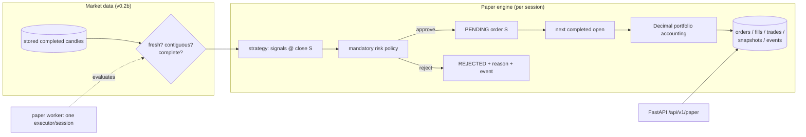

# Driftline paper trading (v0.2c)

An automated, persistent **simulated** trading engine. All funds are virtual;
fills are computed locally from stored candles. Driftline never submits real
orders — the paper engine has no execution adapter besides the local
simulator, and no real-money endpoint is ever contacted.

> Simulated performance is not actual financial performance. Paper profits do
> not predict real-market results (no latency, no spread, no partial fills,
> no market impact).

## Architecture



Module responsibilities (`src/driftline/paper/`):

| Module | Owns |
|---|---|
| `service.py` | `PaperTradingService` logic: session lifecycle, evaluation ticks, order decisions, fill simulation, accounting |
| `store.py` | Session locks, transitions, order/fill/trade/snapshot/event queries |
| `models.py` | SQLAlchemy tables for sessions, orders, fills, trades, snapshots, events |
| `risk_policy.py` | `PaperRiskPolicy` wrapping the base `RiskManager` + daily-loss/kill/position guards |
| `money.py` | Decimal quantization for cash, quantity and price |
| `worker.py` | `PaperWorker` loop: one leased executor per RUNNING session |

Strategy decisions, risk approval, execution simulation and accounting are
separate steps; a strategy signal can never reach accounting without passing
risk. The execution interface (`PENDING order` → `fill at next open`) could
later support alternative *simulated* adapters; real trading is out of scope.

## Configuration

Default paper scope: `binance` BTC/USDT `1h`, EMA crossover, 10,000 USDT,
long-only spot. ETH/SOL and RSI/Donchian work through the same code paths
(the strategy/session market fields are generic) but are not the default
deployment.

| Variable | Default | Purpose |
|---|---|---|
| `DRIFTLINE_PAPER_INTERVAL` | `60` | Worker poll cadence (s) |
| `DRIFTLINE_PAPER_MAX_CANDLES` | `48` | Max new candles per evaluation tick |
| `DRIFTLINE_PAPER_FEE_RATE` | `0.001` | Simulated per-leg fee |
| `DRIFTLINE_PAPER_SLIPPAGE_RATE` | `0.0005` | Simulated slippage |
| `DRIFTLINE_PAPER_ALLOCATION` | `1.0` | Position sizing fraction |
| `DRIFTLINE_PAPER_MIN_QTY` | `0.00001` | Minimum order quantity |
| `DRIFTLINE_PAPER_MAX_DAILY_LOSS` | `0.05` | UTC-day loss limit (entries blocked) |
| `DRIFTLINE_PAPER_MAX_DRAWDOWN` | `0.20` | Peak-equity drawdown limit (entries blocked) |
| `DRIFTLINE_PAPER_MIN_BALANCE` | `10.0` | Minimum cash balance guard |
| `DRIFTLINE_PAPER_MAX_STALE` | `7200` | Max age (s) of the latest completed candle |

Risk parameters are **server-side only**: session creation accepts market,
strategy and capital — any `risk*` field is rejected (`extra: forbid`), so
public API requests cannot relax or disable risk checks.

## Session lifecycle

`CREATED → RUNNING ⇄ PAUSED → STOPPED`, plus `ERROR` after 10 consecutive
evaluation failures (resume clears the count). `STOPPED` is terminal; pending
orders are cancelled on stop — the open position is left intact and marked,
never liquidated synthetically. Only one active (`RUNNING`/`PAUSED`) session
per exchange/symbol/timeframe. Sessions are never created automatically.

## Risk controls (all mandatory, all logged)

- Maximum position allocation, per-trade risk (with stop, when provided),
  minimum balance, invalid-order rejection (base `RiskManager`).
- Maximum simulated daily loss (UTC calendar day; resets at 00:00 UTC;
  blocks entries, exits always allowed).
- Maximum peak-equity drawdown (blocks entries, exits always allowed).
- Single concurrent long position; no pyramid, no short.
- Stale-data rejection (session-level gate + base timestamp checks).
- Persistent kill switch (`POST …/kill`): blocks new entries immediately and
  flattens an open position at the next completed open; survives restarts;
  released with `POST …/unkill`.

These are research guardrails, not a production risk system.

## Idempotency and recovery

- `last_evaluated_ts` cursor: each completed candle evaluated at most once.
- Idempotency key `session:signal-ts:side` with a DB uniqueness constraint —
  redelivered signals never double-order.
- At most one fill per order (DB uniqueness); per-candle snapshots unique per
  session+timestamp.
- One atomic transaction per evaluation tick; mid-tick failures roll back,
  record `consecutive_errors`, and retry with cooldown (10 → `ERROR`).
- Pending orders refill from the next completed open after a restart; no
  repeated trades.
- Exactly one executor per session via DB lease (`locked_by/locked_until`,
  expired leases stolen) plus an in-process guard.

## Operations

```bash
alembic upgrade head
uvicorn driftline.api.main:app --reload          # terminal 1: API (no trading loops)
uv run python -m driftline.paper.worker          # terminal 2: sole paper executor
# or: docker compose up --build                  # db + api + worker + paper
```

Useful endpoints (mutating ones need `X-Driftline-Ops-Token` when configured):

```text
POST /api/v1/paper/sessions                      # create (CREATED)
POST /api/v1/paper/sessions/{id}/start|pause|resume|stop
POST /api/v1/paper/sessions/{id}/kill|unkill
GET  /api/v1/paper/sessions/{id}/portfolio       # cash, position, PnL, equity
GET  /api/v1/paper/sessions/{id}/orders|trades|equity|events
```

Failure recovery: check `last_error` + `events(DATASKIP/SESSION_ERROR)`, fix
the cause (usually market-data freshness — see
[market-automation](market-automation.md)), then `resume`. The cursor resumes
where it stopped; history is never re-executed.
